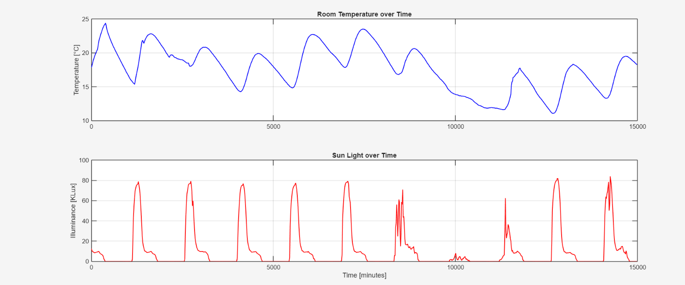
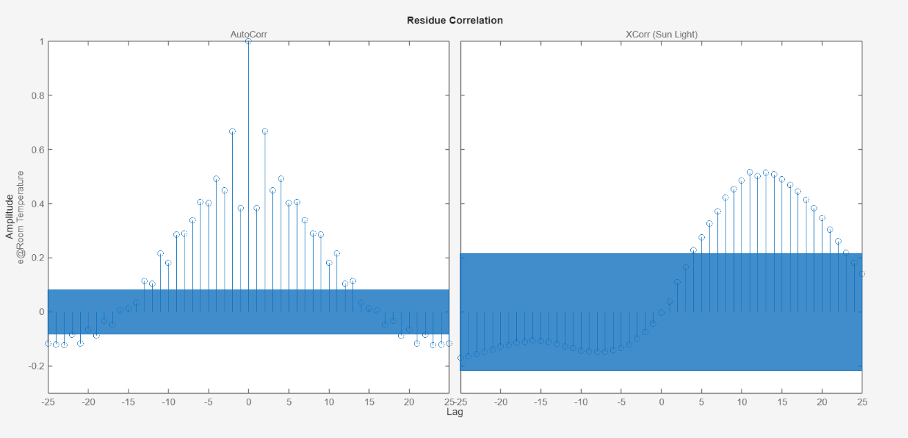
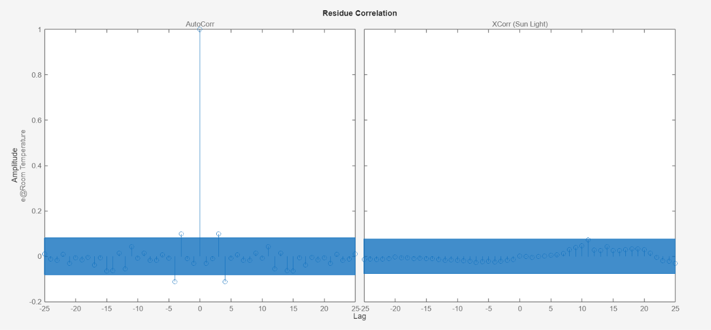
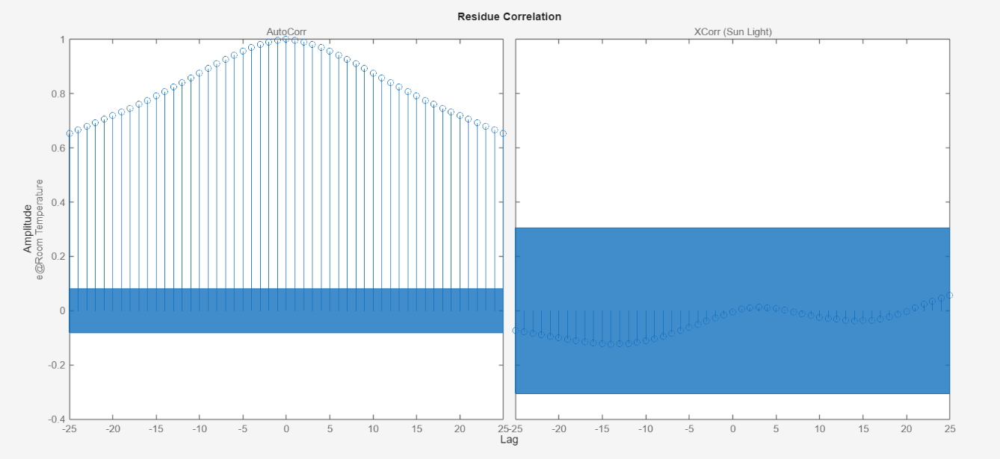
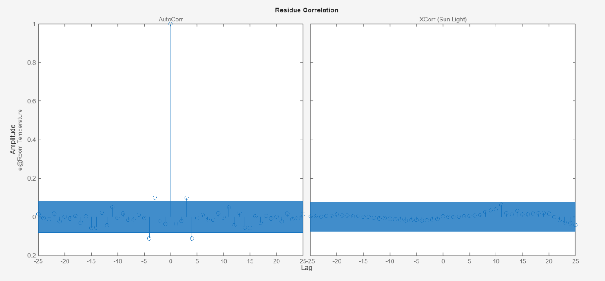
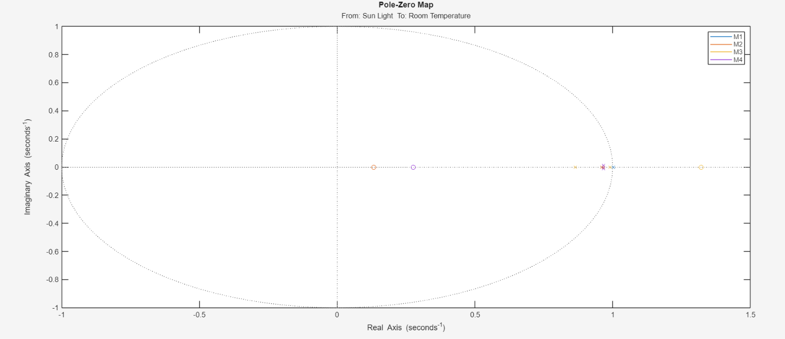
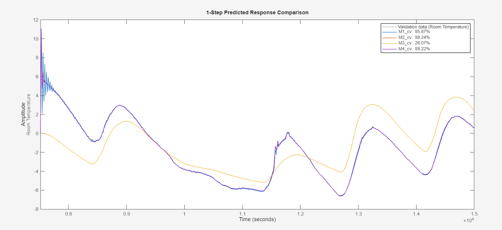
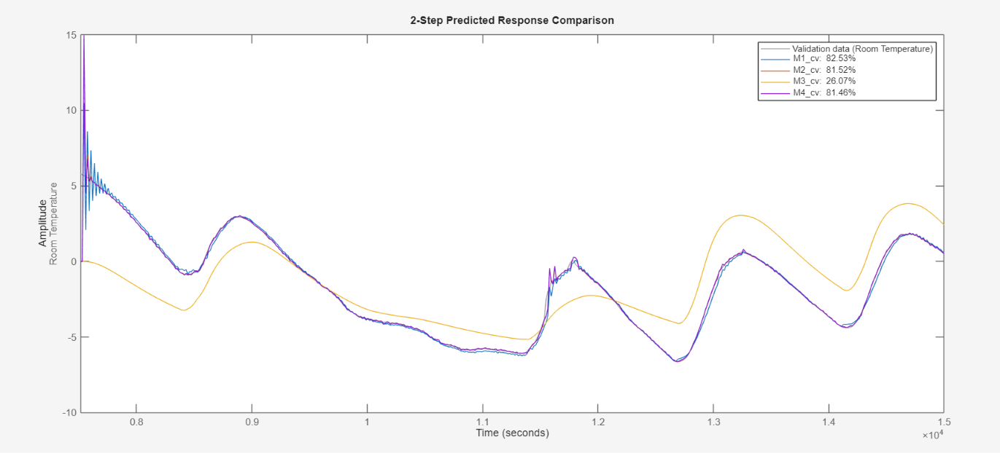
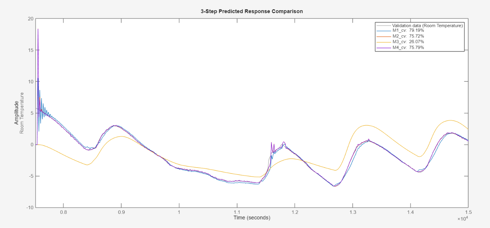
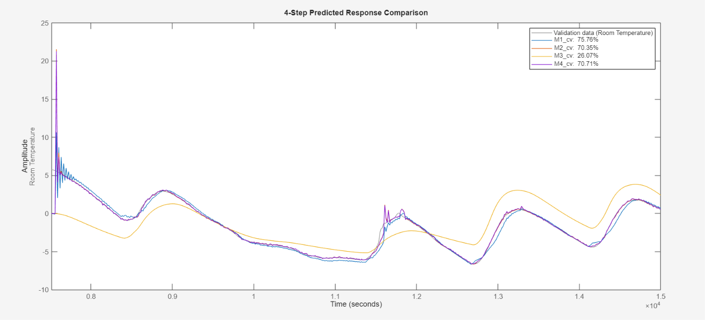

# Room Temperature System Identification

Models and predicts indoor room temperature from solar illuminance by comparing and validating parametric models (`ARMAX`, `Output-Error`, and `Box-Jenkins`) in MATLAB.

---

## Project Overview

This project implements a complete **Parametric System Identification** workflow in MATLAB to model the thermal dynamics of an indoor room subjected to solar radiation. Starting from $N = 1000$ input-output samples collected with a sampling period of $T_s = 15\text{ minutes}$, four linear black-box model structures are estimated, statistically validated, and compared through complexity criteria and multi-step hold-out cross-validation.

---

## Methodology & Pipeline

### 1. System & Data Description
* **Dataset:** `house.mat` ($N = 1000$ samples, total duration $15{,}000\text{ minutes} \approx 10.4\text{ days}$).
* **Sampling Time:** $T_s = 15\text{ minutes}$.
* **Input ($u$):** Sun Light $[\text{KLux}]$.
* **Output ($y$):** Room Temperature $[°\text{C}]$.

### 2. Data Preprocessing (Detrending)
Constant offsets (mean values $\mu_u, \mu_y$) are extracted using `getTrend(data, 0)` and removed via `detrend(data, mu)` so that the zero-mean dataset `data_d` is suitable for linear dynamic modeling.

### 3. Model Structure Design
Four candidate parametric model structures (all with input-output delay $n_k = 1$) are identified on `data_d`:

| Model ID | Family | Orders | Polynomial Structure |
| :--- | :--- | :--- | :--- |
| **M1** | **ARMAX** (1st order) | `[1 1 1 1]` | $n_a = 1,\; n_b = 1,\; n_c = 1,\; n_k = 1$ |
| **M2** | **ARMAX** (2nd order) | `[2 2 2 1]` | $n_a = 2,\; n_b = 2,\; n_c = 2,\; n_k = 1$ |
| **M3** | **Output-Error (OE)** | `[2 2 1]` | $n_b = 2,\; n_f = 2,\; n_k = 1$ |
| **M4** | **Box-Jenkins (BJ)** | `[2 2 2 2 1]` | $n_b = 2,\; n_c = 2,\; n_d = 2,\; n_f = 2,\; n_k = 1$ |

---

## Validation & Model Selection

### 4. Residual Analysis (Whiteness & Independence Tests)
The prediction residuals $\varepsilon(t)$ of each model are evaluated via `resid(..., 'corr')` to verify:
1. **Whiteness:** Autocorrelation of residuals lies within the $99\%$ confidence bounds.
2. **Independence:** Cross-correlation between residuals and past inputs lies within the confidence bounds.

| M1: ARMAX `[1 1 1 1]` | M2: ARMAX `[2 2 2 1]` |
| :---: | :---: |
|  |  |

| M3: Output-Error `[2 2 1]` | M4: Box-Jenkins `[2 2 2 2 1]` |
| :---: | :---: |
|  |  |

### 5. Zero-Pole Cancellation Analysis
To detect over-parameterization and redundant dynamics across the four identified transfer functions, input-output poles and zeros (along with their confidence regions) are inspected via `iopzmap(M1, M2, M3, M4)`:

### 6. Complexity Criteria (`SURE`, `AIC`, `BIC`)
To balance goodness-of-fit (loss function $V$) against model complexity ($d$ estimated parameters over $N$ samples), three information criteria are computed:
* **SURE** (`sure.m`): $\text{SURE} = V \left(1 + \frac{2d}{N}\right)$
* **AIC** (built-in `aic`): $\text{AIC} = N \ln(V) + 2d$ 
* **BIC** (`bic.m`): $\text{BIC} = \ln(V) + \frac{d \ln(N)}{N}$

### 7. Hold-Out Cross-Validation ($h$-Step Ahead Prediction)
The detrended dataset is split equally into:
* **Training set:** First $500$ samples (`1:N/2`) used to re-estimate `M1_cv`, `M2_cv`, `M3_cv`, and `M4_cv`.
* **Validation set:** Last $500$ samples (`N/2+1:N`) used to evaluate out-of-sample predictive accuracy (NRMSE fit %) across prediction horizons $h \in \{1, 2, 3, 4\}$ (corresponding to $15, 30, 45,$ and $60\text{ minutes}$ ahead) with zero initial conditions (`InitialCondition = 'z'`).

| 1-Step Ahead ($h = 1$, $15\text{ min}$) | 2-Step Ahead ($h = 2$, $30\text{ min}$) |
| :---: | :---: |
|  |  |

| 3-Step Ahead ($h = 3$, $45\text{ min}$) | 4-Step Ahead ($h = 4$, $60\text{ min}$) |
| :---: | :---: |
|  |  |
